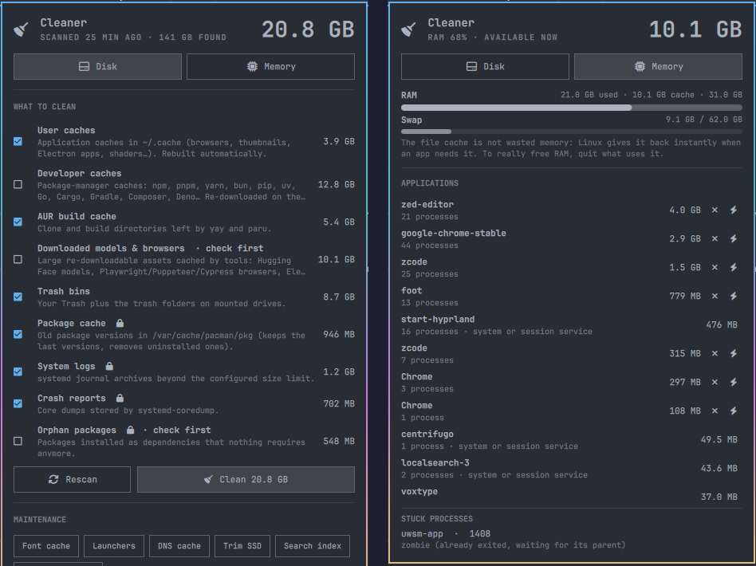

# Omarchy Cleaner

Find and reclaim disk space and memory on [Omarchy](https://omarchy.org). Omarchy Cleaner checks app caches, the pacman cache, system logs, crash dumps, Trash, developer caches, Docker leftovers and large files, then removes what you select. A **Memory** tab shows what really uses your RAM, application by application, and lets you quit it cleanly. It adds a bar widget with a panel to the Omarchy shell. Under the panel is a scriptable CLI that you, your scripts or an AI agent can drive.



- **Scan first, clean second.** Scanning never changes anything. Cleaning always re-scans, then asks for confirmation.
- **Safe defaults.** Only low-risk categories are pre-selected. Large files are listed for review and never removed in bulk.
- **Small root surface.** System items go through a helper that accepts a short, fixed list of actions. It never takes file paths. You authenticate each time with the Omarchy polkit dialog.
- **Remote control.** Every action is available as `omarchy-cleaner … --json`, as shell IPC, or through an optional scheduled scan with notifications.

---

## Requirements

Omarchy Cleaner targets **Omarchy 4 (Quattro shell)** or later. Everything it needs ships with a standard Omarchy install.

| Required | Package | Used for |
|---|---|---|
| `bash` ≥ 5, `jq`, `gawk` | bash, jq, gawk | the CLI, its JSON output, the memory view |
| `du`, `find`, `numfmt`, `flock`, `column` | coreutils, findutils, util-linux | scanning, sizes, locking |
| `pkexec` | polkit | the privileged helper (system items only) |
| `systemctl --user` | systemd | quitting applications from the Memory tab |
| `paccache` | pacman-contrib | the **Package cache** module |

| Optional | Package | Enables |
|---|---|---|
| `docker` | docker | the **Docker leftovers** module |
| `snapper` | snapper | the **Old snapshots** module |
| `yay` / `paru` | AUR helpers | the **AUR build cache** module |
| `notify-send` | libnotify | notifications from scheduled scans |
| `gio` | glib2 | native Trash support (falls back to the freedesktop spec) |
| `fc-cache`, `update-desktop-database`, `updatedb`, `fstrim`, `resolvectl` | fontconfig, desktop-file-utils, plocate, util-linux, systemd | the maintenance tasks |

Modules whose tool is missing are shown as *n/a* with the reason. Nothing is ever installed for you.

## Install

From the Omarchy plugin marketplace, or with the Omarchy CLI:

```bash
omarchy plugin add https://github.com/momostifler96/omarchy-cleaner.git
omarchy plugin enable io.github.momostifler96.omarchy-cleaner
```

The widget lands in the right section of the bar. Move it with `omarchy bar move`.

Optional extras are never set up automatically. Run each one only if you want it:

```bash
P=~/.config/omarchy/plugins/io.github.momostifler96.omarchy-cleaner
$P/bin/omarchy-cleaner link              # put `omarchy-cleaner` on your PATH (~/.local/bin)
omarchy-cleaner schedule enable weekly   # weekly background scan + notification
```

### Install by hand

```bash
git clone https://github.com/momostifler96/omarchy-cleaner.git \
  ~/.config/omarchy/plugins/io.github.momostifler96.omarchy-cleaner
omarchy-shell shell rescanPlugins
omarchy plugin enable io.github.momostifler96.omarchy-cleaner
```

## Remove

```bash
omarchy-cleaner schedule disable   # only if you enabled it
omarchy-cleaner unlink             # only if you ran `link`
omarchy plugin remove io.github.momostifler96.omarchy-cleaner
```

The plugin leaves only its own optional settings and history behind. To delete those too:

```bash
rm -rf ~/.config/omarchy-cleaner ~/.local/state/omarchy-cleaner
```

## Usage

**Bar widget.** Left-click opens the panel. Right-click starts a new scan. Hover shows how much space can be freed.

**Panel.**
- Click a category to select or deselect it. Right-click it to preview its largest items.
- **Clean** asks for confirmation. System items (🔒) also ask for your password.
- **Large files** is review-only: expand it to open the containing folder or move a single file to Trash.
- The **Maintenance** buttons run one-off tasks.

**Memory tab.**
- Shows RAM and swap usage, plus the file cache. Linux gives that cache back instantly when an app needs it, so it is not wasted memory.
- Lists your applications by real memory use (PSS: shared memory is split fairly, not counted twice).
  - Each app launched from Omarchy is one entry, with all its helper processes.
  - Commands started from a terminal belong to that terminal's entry. Click it to see them and quit one at a time.
- ✕ quits an app cleanly (SIGTERM, so it can save and exit). ⚡ force-quits it (SIGKILL). Both ask for confirmation.
- The desktop session (Hyprland, the Omarchy shell, portals, audio…) is never offered for quitting.
- **Stuck processes** lists stopped processes, which can be force-quit, plus zombie and disk-wait processes, explained since no signal removes them.

> **Why there is no "Free RAM" button.** The equivalent on Linux is dropping the kernel file cache. It only makes the "free" number look better for a few minutes, while the system re-reads files from disk. It is available under Maintenance → **Drop file cache** for completeness, behind a warning. Quitting what uses memory is what actually frees it.

**Widget settings** (Bar settings, or inline in `~/.config/omarchy/shell.json`):

| Key | Default | Meaning |
|---|---|---|
| `showSize` | `false` | show the reclaimable size next to the icon |
| `autoScanHours` | `6` | re-scan in the background when the last scan is older than this (0 = off) |

### What gets cleaned

| Module | What | Root | Pre-selected | Risk |
|---|---|:-:|:-:|---|
| `user-cache` | App caches in `~/.cache` (browsers, thumbnails, Electron apps, shaders…) | | ✓ | low |
| `aur-cache` | yay / paru clone and build directories | | ✓ | low |
| `trash` | Your Trash and the trash folders on mounted drives | | ✓ | low |
| `pacman-cache` | Old package versions (keeps the last 2) and packages no longer installed | 🔒 | ✓ | low |
| `journal` | systemd journal beyond 200 MB | 🔒 | ✓ | low |
| `coredumps` | Crash dumps in `/var/lib/systemd/coredump` | 🔒 | ✓ | low |
| `dev-cache` | npm, pnpm, yarn, bun, pip, uv, Go, Cargo, Gradle, Composer, Deno… caches | | | low |
| `broken-entries` | Launchers and autostart entries whose program is gone (moved to Trash) | | | low |
| `downloaded-assets` | Hugging Face models, Playwright/Puppeteer/Cypress browsers, Electron binaries… | | | medium |
| `orphans` | Packages that were installed as dependencies and are no longer needed | 🔒 | | medium |
| `snapper` | Snapshots past snapper's own `number` retention rule | 🔒 | | medium |
| `docker` | Stopped containers, unused networks, dangling images, build cache. **Never volumes** | | | medium |
| `large-files` | Files over 1 GB in your home folders. **Review only** | | | high |

The pre-selection is a default. Change it permanently with `omarchy-cleaner config set selection '["user-cache","trash"]'`.

### Never touched

- Anything outside your home folder, except through the fixed root actions above.
- Your home folder itself and the top-level `~/.config`, `~/.local/share` and `~/.cache` folders. Cache folders are emptied, never deleted.
- `~/.cache/omarchy`, `~/.cache/quickshell`, and cache entries named `*.bak`, `*.backup`, `*.orig` or `*.old`.
- Every path in your ignore list: `omarchy-cleaner ignore add PATH`.
- Symlinks are removed, never followed. Removal never crosses filesystems.

## Remote control

The panel is a thin client of the CLI, so anything it does can be automated.

**CLI with JSON.** Full reference in [docs/CLI.md](docs/CLI.md).

```bash
omarchy-cleaner scan --json                          # what can be freed, per module
omarchy-cleaner clean user-cache trash --yes --json  # clean named modules
omarchy-cleaner clean --defaults --dry-run --json    # preview the pre-selection
omarchy-cleaner maintain font-cache desktop-db --yes # maintenance tasks
omarchy-cleaner status --json                        # last scan summary (cheap)
omarchy-cleaner memory --json                        # RAM, swap, apps by memory, stuck processes
omarchy-cleaner memory quit UNIT --yes               # quit an app cleanly (--force for SIGKILL)
omarchy-cleaner memory kill PID --yes                # quit one process
```

Without a terminal, `clean`, `maintain`, `trash` and `memory quit/kill` refuse to run unless you pass `--yes` (exit code 3). This is deliberate for scripts and agents.

**Shell IPC** (through the running Omarchy shell):

```bash
T=io.github.momostifler96.omarchy-cleaner
omarchy-shell $T toggle          # open / close the panel (also: open, close)
omarchy-shell $T showMemory      # open on the Memory tab (showDisk for the Disk tab)
omarchy-shell $T scan            # rescan in the background
omarchy-shell $T cleanDefaults   # clean the pre-selected modules
omarchy-shell $T status          # JSON: busy, status, sizes, last scan
```

To open the panel from a keyboard shortcut, bind any key in your Hyprland bindings to the command
`omarchy-shell io.github.momostifler96.omarchy-cleaner toggle`.

**Scheduled scan.** `omarchy-cleaner schedule enable [daily|weekly|monthly]` installs a systemd user timer. It scans with low priority and sends a notification when at least 1 GB (`notifyThresholdMB`) can be freed. It never cleans on its own.

The bar widget watches `~/.local/state/omarchy-cleaner/last-scan.json`, so a scan or clean started from anywhere updates the widget immediately.

## Configuration

The config file is optional and only written by `omarchy-cleaner config set` and `ignore add/remove`. It lives at `~/.config/omarchy-cleaner/config.json`.

| Key | Default | Meaning |
|---|---|---|
| `pacmanKeep` | `2` | package versions kept per package |
| `journalMaxMB` | `200` | journal size to keep |
| `largeFileMinMB` | `1024` | size threshold for **Large files** |
| `notifyThresholdMB` | `1024` | minimum reclaimable size before a scheduled scan notifies |
| `selection` | — | module ids pre-selected by `clean --defaults` and the panel |
| `ignore` | `[]` | paths or globs never scanned or cleaned |

## Security

Plugins run unsandboxed inside `omarchy-shell`. Read the code before enabling, as with any plugin. Specifically:

- The QML runs only the bundled `bin/omarchy-cleaner` and `xdg-open`. It makes no network calls.
- `bin/omarchy-cleaner-root` is the only code that runs as root. It runs through `pkexec`, so every use needs your password, and it accepts only these verbs: `pacman-cache N`, `journal N`, `coredumps`, `orphans`, `snapper`, `dns-flush`, `trim`, `locate-db`, `drop-caches`. Each verb maps to one fixed command, listed at the top of the file.
- The Memory tab can only signal processes you own. It refuses the desktop session components and the terminal the CLI runs in, and it always asks before quitting.
- Installing the plugin runs nothing. It never edits `shell.json`, Hyprland or any other configuration.

## Troubleshooting

- **A module shows *n/a*.** Its tool is missing or not reachable. The reason is shown, for example when you are not in the `docker` group.
- **System items fail with "not authorized".** The password prompt was cancelled, or no polkit agent is running. From a terminal, `pkexec` falls back to a text prompt.
- **Logs.** Run `quickshell log -p /usr/share/omarchy/shell | grep omarchy-cleaner`.
- **History.** Run `omarchy-cleaner history` to see what was cleaned and when.

## Development

```bash
tests/run.sh -v                       # full test suite in a throw-away $HOME (no root, no real files)
shellcheck -x bin/* lib/*.sh tests/run.sh
omarchy plugin validate .
```

The architecture and module contract are documented in [docs/ARCHITECTURE.md](docs/ARCHITECTURE.md).

## License

[MIT](LICENSE) © 2026 momoledev
